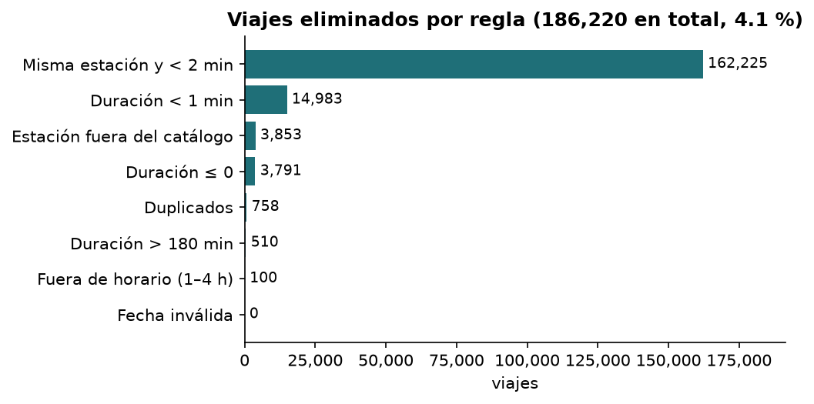
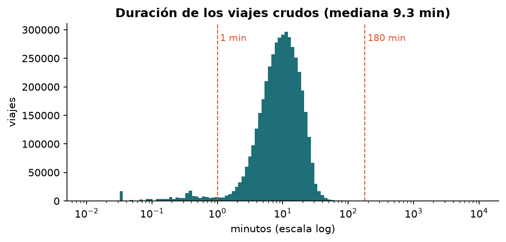
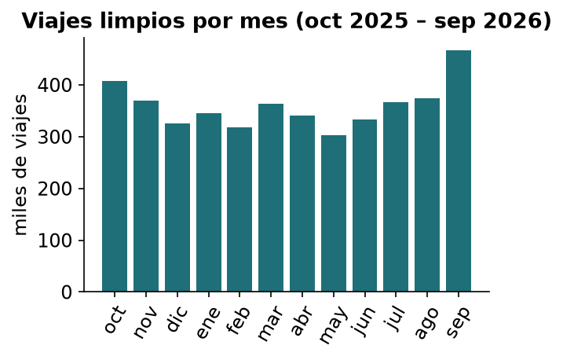
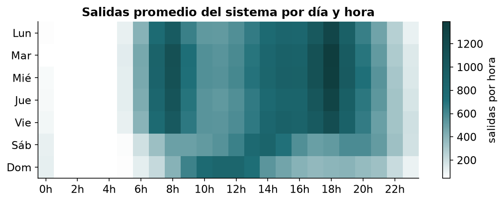
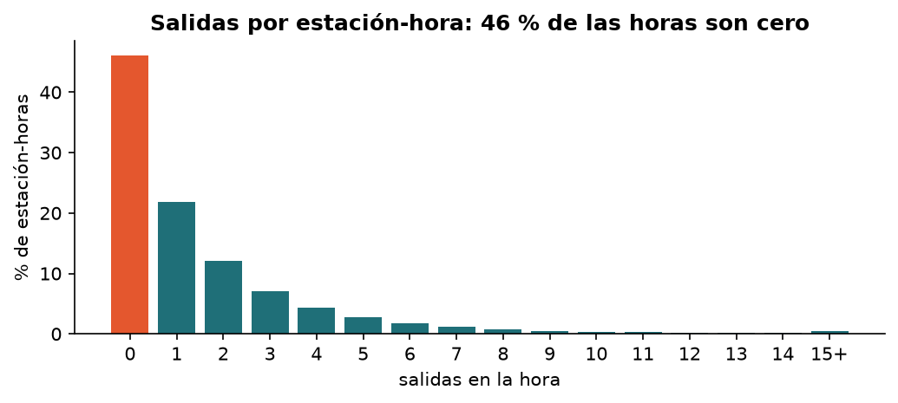
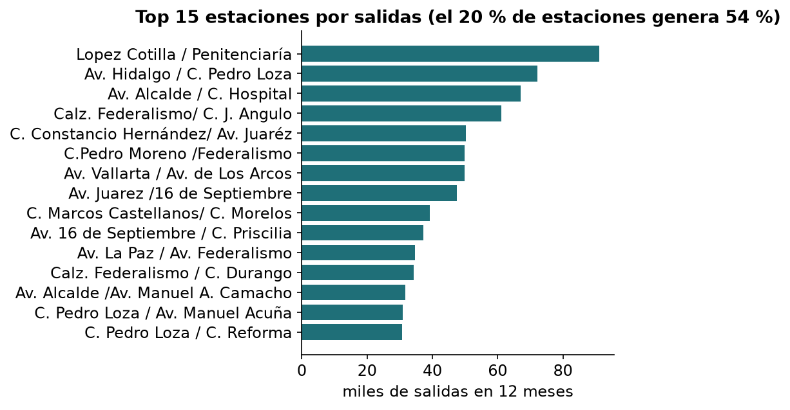
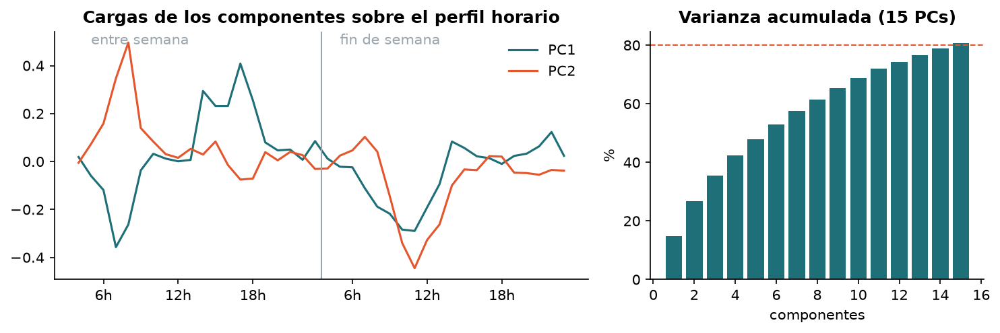
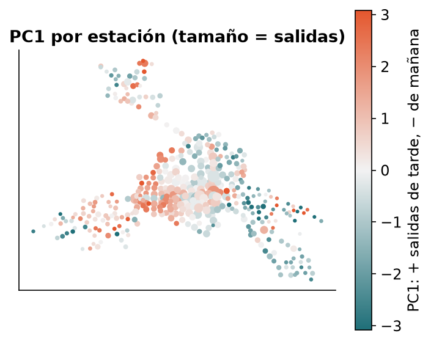

# Hallazgos del EDA — Fase 1

**Rol:** Data Scientist (Daniel Romero) · **Datos:** viajes de MiBici de oct 2025 a sep 2026 (v1 limpia, 4,311,657 viajes) y
panel estación-hora (v2 y v3). Las figuras están en `reports/figures/` y también en MLflow (run `eda-figuras`).
Las cifras marcadas con ≈ se leen de la gráfica; las demás salen de `reports/reporte_limpieza.json` y del README.

## Interpretación por figura

### 1. Viajes eliminados por regla

La limpieza quita el 4.1 % de los viajes y casi todo es una sola regla: 162,225 arranques fallidos (misma estación y
menos de 2 min) son el 87 % de lo eliminado. Las otras siete reglas juntas suman 24 mil viajes, así que la demanda
limpia depende sobre todo de cómo se define «viaje real»; si en la Fase 2 cambia ese umbral, conviene registrarlo
como una nueva versión del dataset.

### 2. Duración de los viajes crudos

La duración es unimodal en escala logarítmica, con mediana de 9.35 min: MiBici se usa para trayectos cortos de
última milla. Los cortes de 1 y 180 min caen en las colas, lejos del cuerpo de la distribución, por lo que separan
registros técnicos y bicis mal ancladas sin recortar viajes normales.

### 3. Viajes limpios por mes

La demanda mensual oscila entre ≈300 mil (mayo) y ≈465 mil (septiembre), con caídas en diciembre, febrero (que
además tiene 28 días) y mayo.
Septiembre 2026, que es justo la partición de **prueba**, es el mes más alto del año (≈35 % arriba del promedio de los
meses de entrenamiento, oct–jun): el modelo puede subestimar el nivel de demanda, así que hay que vigilar el
sesgo del error en prueba y no solo el MAE.

### 4. Salidas promedio por día y hora

Entre semana el patrón es de traslado al trabajo o la escuela, con dos picos (7–8 h y 17–18 h, hasta ≈1,300 salidas
por hora en todo el sistema). El fin de semana cambia por completo: el sábado tiene una meseta al mediodía y el
domingo un pico de 10 a 13 h, compatible con un uso recreativo. Por eso `hora_dia`, `dia_semana` y
`fin_de_semana` (y su codificación cíclica) son las variables base del modelo.

### 5. Distribución de salidas por estación-hora

El 46 % de las estación-horas tiene cero salidas y la cola derecha es larga (hay horas con 15 o más). Es un
problema de **conteos con muchos ceros**, no una variable normal: eso justifica la pérdida Poisson del
HistGradientBoosting y usar MAE y RMSE juntos, porque el RMSE castiga los pocos picos grandes que el MAE diluye.

### 6. Top 15 estaciones

La demanda está muy concentrada: el 20 % de las estaciones genera el 54 % de las salidas, y la primera
(López Cotilla / Penitenciaría) tiene ≈91 mil en 12 meses. Un error promedio global puede esconder que el modelo
falla en las estaciones que más importan para el rebalanceo; en la Fase 2 conviene reportar también el error de
las estaciones con mayor demanda.

### 7. Componentes principales del perfil horario

PC1 contrasta las salidas de la mañana (carga negativa a las 7–8 h) con las de la tarde (carga positiva de 14 a 18 h)
entre semana; PC2 separa el pico de las 8 h entre semana del de media mañana del fin de semana. Que hagan falta 15
componentes para explicar el 80.7 % de la varianza (PC1 solo ≈15 %) indica que no hay un único tipo de estación:
los perfiles son diversos y vale la pena probar también un agrupamiento de estaciones.

### 8. PC1 por estación en el mapa

PC1 tiene estructura geográfica: las estaciones naranjas (de donde salen bicis en la tarde) predominan en la zona
central y en el brazo norte, que funcionan como **destino** de la mañana, y las verde azulado (salen en la mañana),
concentradas en el brazo oriente-sureste, se comportan como **origen** residencial. Esa asimetría es justo la que vacía unas estaciones y satura otras, y respalda usar `lat`,
`lon`, `municipio` y los componentes PCA como variables.

## Tres ideas de variables para la Fase 2

1. **Clima por hora (lluvia y temperatura).** La validación (jul–ago) y la prueba (sep) caen en temporada de
   lluvias de Guadalajara, cuando las tormentas suelen llegar en la tarde, justo en el pico de las 17–18 h.
   Fuente posible: API histórica horaria de Open-Meteo con las coordenadas del centro del sistema.
2. **Calendario académico y eventos.** Vacaciones escolares y universitarias (diciembre, Semana Santa, verano), que
   explicarían las caídas de diciembre y mayo y el salto de septiembre, más marcas de eventos recurrentes: el pico
   del primer sábado del mes de 20 a 22 h en la estación 194 (Av. Vallarta / Av. de Los Arcos) y los domingos por la
   mañana (hipótesis por validar: la Vía RecreActiva).
3. **Demanda de las estaciones vecinas.** Rezago espacial: el promedio de salidas de la hora anterior en las k
   estaciones más cercanas. Si una estación vecina se vacía, la demanda se desplaza; la Figura 8 muestra que las
   estaciones cercanas se parecen, así que esta información debería ayudar sobre todo en el horizonte de 1 h.

---
*Uso de IA:* Anthropic. (2026). *Claude Opus 5.5* [Modelo de lenguaje grande], utilizado para redactar este reporte a
partir de las figuras y cifras del pipeline; el contenido fue revisado por Daniel Romero.
