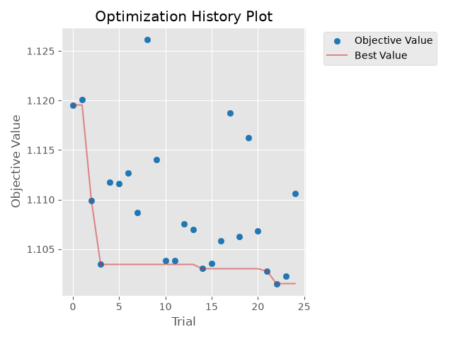
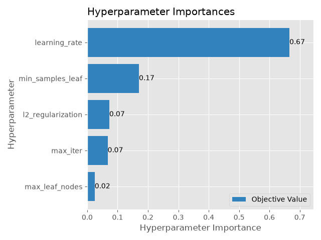

# Selección de modelos y ajuste de hiperparámetros — Fase 2

**Rol:** Data Scientist (Daniel Romero) · **Datos:** v3 `demanda-v3` · **Horizonte:** 24 h (pronóstico hecho la noche
anterior: sin `lag_1h` ni `media_24h`) · **Experimento MLflow:** `mibici-fase2-modelos` · **Comando:** `make tune`
(`python -m mibici.modeling.tune`). Las cifras salen de [`comparacion_modelos_24h.csv`](comparacion_modelos_24h.csv).

## Por qué estos algoritmos

La demanda es un **conteo con muchos ceros**: el 46 % de las estación-horas no tiene salidas y la cola derecha es larga
([hallazgos del EDA](hallazgos_eda.md), figura 5). La meta del [ML Canvas](../references/ml_canvas.md) es bajar el MAE
al menos 10 % frente a la persistencia semanal (misma hora de la semana anterior).

| Familia | Por qué se probó |
|---|---|
| Regresión de Poisson (GLM, liga log) | Es la referencia para conteos: predice medias positivas y sus coeficientes se interpretan. Si un modelo lineal bastara, no haría falta nada más complejo. |
| Bosque aleatorio | Capta interacciones no lineales (hora × tipo de estación) promediando árboles independientes; es poco sensible a los hiperparámetros. |
| HistGradientBoosting con pérdida Poisson | Une la flexibilidad de los árboles con la pérdida propia de un conteo y escala a millones de filas. Era la línea base de la Fase 1, sin ajustar. |

## Cómo se ajustó

- **Optuna** con búsqueda bayesiana (TPE, semilla 42), 25 pruebas por familia. Cada prueba es un run anidado en MLflow
  con sus hiperparámetros, MAE, RMSE, devianza de Poisson, sesgo, MAE en las estaciones de mayor demanda y segundos de
  ajuste.
- Cada prueba entrena con una muestra de 400,000 filas del entrenamiento (oct 2025 a jun 2026) y se evalúa con toda la
  validación (jul y ago 2026, 552,001 filas). Optuna minimiza la **devianza de Poisson**, la métrica que corresponde a
  un modelo de conteos.
- El mejor juego de cada familia se **reentrena con todo el entrenamiento** (1,973,154 filas), se evalúa en validación
  y **una sola vez en prueba** (sep 2026, 279,497 filas), y el modelo queda guardado en el run padre.
- **Dos rondas.** En la primera, el mejor boosting quedó en el límite del rango (600 iteraciones, el máximo permitido),
  y ese hiperparámetro explicaba el 73 % de la mejora; el bosque también quedó en los bordes. En la segunda se
  ampliaron los rangos (tabla de abajo). El boosting eligió 1,000 iteraciones con una tasa de aprendizaje menor y el
  mismo error (MAE de validación 0.8603 → 0.8608): el límite no lo frenaba. El bosque mejoró de 0.915 a 0.901, pero
  volvió a pegarse a los bordes, hacia árboles más grandes.

| Familia | Hiperparámetro | Rango (ronda 2) | Mejor valor |
|---|---|---|---:|
| Regresión de Poisson | `alpha` (regularización) | 1e-6 a 1, log | 0.165 |
| Bosque aleatorio | `n_estimators` | 50 a 250 | 250 |
| | `max_depth` | 8 a 22 | 16 |
| | `min_samples_leaf` | 30 a 1,000, log | 30 |
| | `max_features` | 0.3 a 0.8 | 0.597 |
| HistGradientBoosting Poisson | `learning_rate` | 0.02 a 0.3, log | 0.0374 |
| | `max_iter` | 200 a 1,500 | 1,000 |
| | `max_leaf_nodes` | 15 a 255, log | 48 |
| | `min_samples_leaf` | 20 a 500, log | 222 |
| | `l2_regularization` | 0.001 a 10, log | 0.0502 |

## Resultados (horizonte 24 h)

| Modelo | MAE valid | MAE prueba | RMSE prueba | Devianza prueba | Sesgo prueba | MAE prueba, 20 % de estaciones con más demanda |
|---|---:|---:|---:|---:|---:|---:|
| Persistencia semanal | 1.014 | 1.169 | 2.171 | — | −0.140 | 2.375 |
| Regresión de Poisson | 1.255 | 1.399 | 3.129 | 2.065 | −0.067 | 2.601 |
| Bosque aleatorio | 0.901 | 1.040 | 1.783 | 1.316 | −0.153 | 2.007 |
| **HistGradientBoosting Poisson** | **0.861** | **1.000** | **1.704** | **1.271** | −0.234 | **1.896** |

MAE y RMSE en bicis por estación y hora. El sesgo es la predicción media menos la real: negativo = el modelo se queda
corto. La devianza no aplica a la persistencia, porque predice ceros exactos y la devianza de Poisson exige
predicciones positivas.

- **El boosting gana en todas las métricas.** Baja el MAE 15.1 % en validación y 14.4 % en prueba frente a la
  persistencia semanal, así que cumple la meta del ML Canvas. En las estaciones de mayor demanda, las que importan
  para el rebalanceo, la mejora es de 20.2 %.
- **El modelo lineal no alcanza:** queda peor que la persistencia. Sin árboles no capta interacciones como «estación
  de oficinas a las 8 h», lo que justifica los modelos basados en árboles.
- **Ajustar hiperparámetros aporta poco frente a elegir bien el algoritmo.** El boosting pasó de 0.875 (configuración
  por defecto de la Fase 1) a 0.861 en validación (−1.6 %); casi toda la ganancia viene de usar árboles con la pérdida
  correcta para conteos.
- **El bosque queda en segundo lugar y es mucho más pesado:** su modelo ocupa 176 MB contra 8.8 MB del boosting, lo que
  importa para servirlo en un contenedor en la Fase 3.

En la ronda 2, la tasa de aprendizaje explica el 67 % de la variación de la devianza entre pruebas; con suficientes
iteraciones, el número exacto de ellas ya casi no importa (7 %).

## Recomendación

Registrar el **HistGradientBoosting con pérdida Poisson** de la ronda 2 como candidato en el Model Registry: es el mejor en
todas las métricas, pesa 8.8 MB y predice rápido. Su run padre en `mibici-fase2-modelos` se llama `hgb_poisson-24h`
y guarda los hiperparámetros (`mejor_*`), las métricas de validación y prueba (`*_valid`, `*_test`), las figuras de
Optuna, la lista de variables y el modelo. Para reconstruirlo en código: `MODELS["hgb_poisson"](best_params)`.

## Qué vigilar

- **Septiembre se subestima** (sesgo −0.23 bicis por hora en prueba). El EDA lo anticipaba: septiembre es el mes más alto
  del año, ≈35 % arriba del promedio de los meses de entrenamiento. Antes de pronosticar un mes nuevo conviene reentrenar
  con los meses más recientes (julio y agosto incluidos) y, en la Fase 3, vigilar este desvío como data drift.
- **El error se concentra donde más importa:** el MAE de las estaciones de mayor demanda (1.9) duplica el global (1.0).
  El monitoreo debería reportarlo por separado.

## Interacción con los otros roles

- **Data Engineer:** los modelos consumen v3 tal como sale del pipeline. Al reproducirlo apareció un problema: el
  catálogo `nomenclatura_2026_09.csv` ya no existe en mibici.net (HTTP 404); el portal publica ahora
  `nomenclatura_2026_10.csv`, con 470 estaciones en lugar de 484 y en latin-1. El original se recuperó del Internet
  Archive (misma huella SHA-1 que la copia archivada el 9-oct) y con él los conteos v0–v3 y la línea base coinciden
  exactamente con el README. Conviene guardar el catálogo en el repositorio o en DVC.
- **ML Engineer:** integra el estimador ganador en el pipeline de scikit-learn y lo registra en el Model Registry.
- **Software Engineer / DevOps:** `tests/test_tune.py` corre en el CI con datos sintéticos (no necesita MLflow ni
  descargas) y `make tune` repite el experimento completo (≈25 min en 24 núcleos).

## Uso de inteligencia artificial

Anthropic. (2026). *Claude Opus 5.5* [Modelo de lenguaje grande]. Se utilizó para escribir `mibici/modeling/tune.py` y
sus pruebas, correr los experimentos y redactar este documento. Los criterios de evaluación (sesgo y error en las
estaciones de mayor demanda) salen de los hallazgos del EDA de la Fase 1. El código pasa por la revisión de otro
integrante del equipo en el pull request antes de integrarse a `main`.
